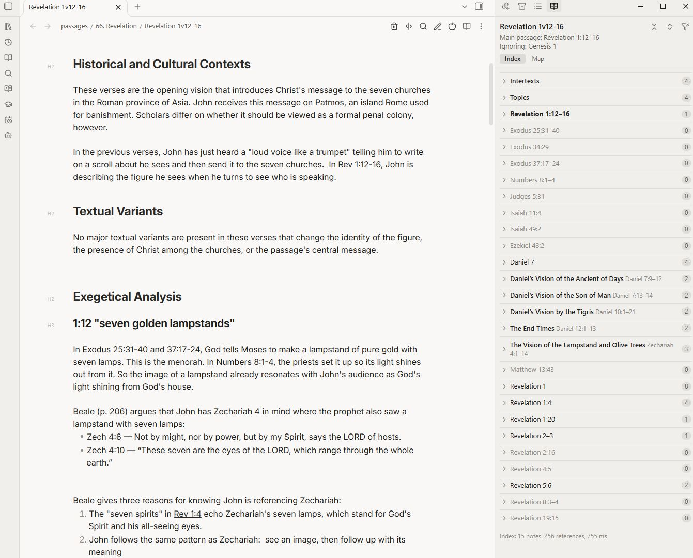
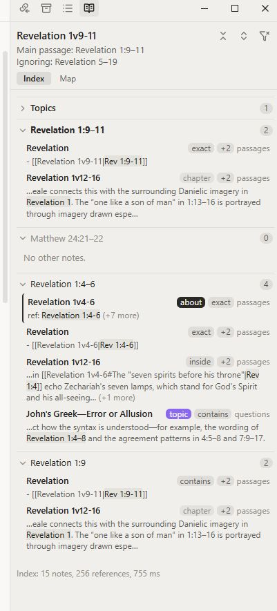
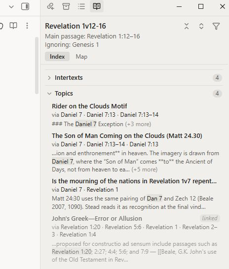
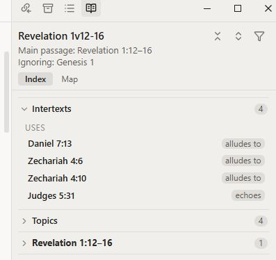
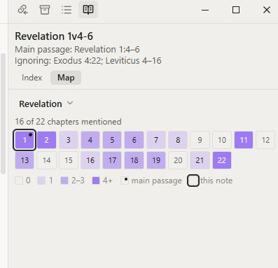
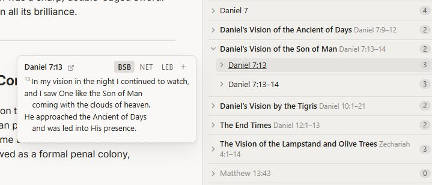
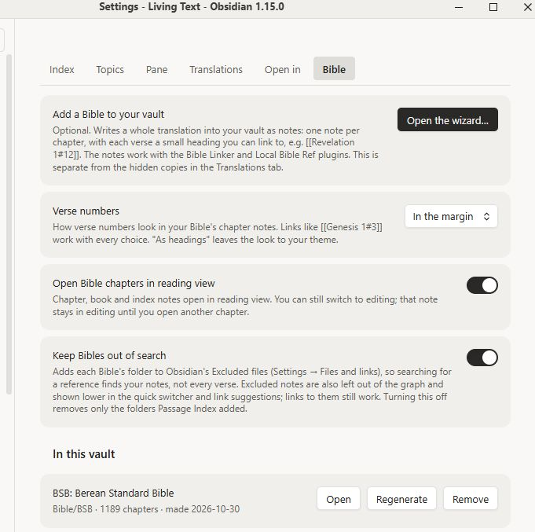

# Passage Index

A side pane that follows your reading. Open a note, and Passage Index shows every other note in your vault that touches the same Bible passages, so you don't have to remember to search.

Desktop only.



## What it reads

Passage Index reads scripture references in every note and treats variants as the same verse:

- `Mark 11:17`, `Mk 11:17`, `Mark 11.17`, `Mark 11v17`, `Isa. 56:7`, `1 Sam 3:4`, `I Sam 3:4`
- **Ranges:** Mark 11:17 falls inside Mark 11:15–19. Ranges across chapters work too (`14:62–15:1`).
- **Chains:** `Dan 9:27; 11:31; 12:11` gives three Daniel references. So do `Rom 8:28, 30` and `Isa 41:4, 44:6 and 48:12`.
- **References in parentheses:** `Zech 14 (cf. 14:4; also 14:21)`.
- **Filenames:** `Isaiah 56v7.md` or `The Son of Man (Matt 24.30).md`. The passage in a note's filename is its **main passage**. A `passage:` property in frontmatter overrides it.
- **Beyond the Bible:** 1–2 Enoch, Jubilees, the Testaments of the Twelve Patriarchs, the Testament of Job, 1QS, 1QM, CD, the Apocrypha and 4 Ezra (chapter:verse forms).

Links count by their display text. A link without display text counts only if the linked note's name starts with a passage (`[[Mark 1v15]]`).

## The pane

Open it from the ribbon icon or the command **Passage Index: Open pane**. It updates whenever you open a note, and re-reads a note shortly after you stop typing.

The pane has two tabs, **Index** and **Map**. The Index tab has three parts: passage groups, **Topics** and **Intertexts**.

### Index

- One group per passage the note cites. The main passage comes first, the others follow in canonical order, each with a note count.
- Within a group, notes **about** the passage (their own main passage overlaps it) come first, then exact matches, then ranges, then chapter-only mentions.
- Each result shows the folder and the line with the reference highlighted.
- **Click** a result to open it in a new tab with the cursor on that line. The reference is briefly highlighted.
- **Hover** a result to preview the note at that line (this follows Obsidian's Page preview setting).
- **Hold Ctrl** (Cmd on a Mac) and point at a passage heading to read the verses (see *Verse pop-up*).



#### Right-click a result

- **Open in new tab** or **Open to the right**.
- **Insert link at cursor:** puts a link to that note where your cursor is in the note you're reading. Select some text first and it becomes the link's display text. In reading view there's no cursor, so the link is copied instead.
- **Copy link**, **Copy this line**, **Reveal in file explorer**.

#### Right-click a passage heading

- **Open in Logos** (and Bible Gateway, Blue Letter Bible or STEP Bible, if you turn them on in the *Open in* tab). Logos opens in the app if it's installed, otherwise on the web.
- **Show in this note:** jumps to where the note you're reading cites the passage.
- Open the note about this passage, copy the passage, copy links to all its notes as a list, or open them all in tabs.
- Collapse or expand the groups.

### Topics

Lists topic notes that share a passage with the note you're reading, unlinked ones first, so you can see which topics you haven't linked yet. Which notes count as topics is set in the *Topics* tab.



### Intertexts

Record where a passage quotes, alludes to or echoes another text, and the pane shows it from both ends.

Add an `## Intertexts` heading to a note (any level works; to use another name, such as *Intertextual Connections*, add it in the Index tab of settings) and list one intertext per line. The first reference on each line is the passage being used:

```markdown
## Intertexts

- [[Isaiah 56v7]] (quotes; France 2002, 445)
- [[Jeremiah 7v11]] (quotes) — "den of robbers"
- [[Jeremiah 8v13]] (echoes; Edwards 2002, 342)
- Zech 14:21 (alludes to) — no trader in the house of the Lord
```

**The word in parentheses** sets the kind of use. Passage Index looks only at the start of the word, so these forms all work:

| Kind | Write any of |
|---|---|
| quotes | quotes, quoted, quotation |
| alludes to | alludes to, allusion, allusive |
| echoes | echoes, echo |

Anything else (for example *mentions*), or no parentheses, is listed without a kind. After a `;`, the rest is the citation. After ` — `, a short description.

**Open questions** go anywhere in a note as tasks tagged `#intertext`:

```markdown
- [ ] Does Jer 8:13's fig imagery explain the fig tree? #intertext
```

**What the pane shows** in the Intertexts section:

- **Uses:** this note's own intertext lines. Clicking one opens the used passage's note (e.g. `Isaiah 56v7`), if you have one.
- **Used by:** other notes' intertext lines that point into this note's main passage. Open `Isaiah 56v7` and you see that Mark 11:17 quotes it.
- **Open:** other notes' unfinished `#intertext` tasks naming this passage.



### Map

A coverage map of the main passage's book: one square per chapter, shaded by how many references fall in it (none, 1, 2–3, 4+). Click a chapter to see its verses; click a square to list the notes covering it. Your current note's verses are outlined. Pick any other book from the book list.



The command **Insert coverage map** adds a live `pi-map` code block to a note:

````
```pi-map
Revelation
```
````

## Verse pop-up

Hold **Ctrl** (Cmd on a Mac) and point at a passage in the pane to read the verses. The pop-up uses a hidden copy of a translation that Passage Index downloads once (see *Translations*).



The small arrow beside the reference in the pop-up opens the passage in Logos, Bible Gateway, Blue Letter Bible or STEP Bible. With one of them turned on, it goes straight there; with several, it shows a menu.

## Settings

### Index

- **Excluded folders:** notes here are never indexed.
- **Not references:** phrases that look like passages but aren't, such as a book title you cite (`Mark 1–8`).
- **Ignore property:** a frontmatter property listing references a note cites only in passing, e.g. `pi-ignore: [Acts 11:28]`. The note gets no group for them and won't appear under them elsewhere. The command **Ignore (or stop ignoring) the reference at the cursor in this note** edits it for you.
- **Intertexts headings:** the heading names that start a note's Intertexts section, one per line (default *Intertexts* and *Intertext*). Any heading level; the whole heading must match; case is ignored.
- **Rebuild index:** rarely needed; notes are re-read as you edit them.

### Topics

Topic notes are notes about a subject rather than a passage. A note counts as a topic if a frontmatter property (e.g. `type: topic`) has one of the values you list, or if it sits in one of your topic folders.

### Pane

- **Group passages by section (pericopes):** groups the note's passages under a translation's section headings (BSB, LEB or TCENT; download one in the Translations tab).
- **Hide broad matches** and **Hide chapter-only mentions**, with a button in the pane to show them.
- **Highlight duration** and **Hover previews**.

### Translations

Downloads translations as hidden copies (in the plugin's folder, not notes) for the verse pop-up and for sections. Each downloaded translation shows its license and terms. Translations come from [bible.helloao.org](https://bible.helloao.org); any id from its list can be used.

### Open in

Turn on the apps you want in the right-click menu and the pop-up: **Logos**, **Bible Gateway**, **Blue Letter Bible**, **STEP Bible**. Each can open a set version; leave it blank for the site's default. Bible books only.

### Bible

**Add a Bible to your vault** (optional) opens a wizard that writes a whole translation into your vault as notes: one note per chapter, each verse a small heading you can link to (`[[Revelation 1#12]]`). Options include section headings, footnotes, previous/next links, index notes, aliases and Breadcrumbs properties. These notes are separate from the Translations tab's hidden copies. The Bible's folder is excluded from the index automatically.

Also here: how verse numbers look, opening chapters in reading view, and keeping Bibles out of Obsidian's search. Each Bible you've added can be opened, regenerated or removed (to the trash).



## Network use

Passage Index reads your notes locally. It goes online only when you ask it to:

- downloading a translation (Translations tab) or adding a Bible (Bible tab), from `bible.helloao.org`;
- opening a passage in Logos (`ref.ly`), Bible Gateway, Blue Letter Bible or STEP Bible, in your browser or app.

No telemetry, no accounts.

## Omnisearch

If you add a Bible to your vault and use Omnisearch, turn on Omnisearch's option to respect Obsidian's excluded files. Otherwise the Bible's chapters fill your search results even with *Keep Bibles out of search* on.

## License

MIT. Translations keep their own licenses, shown in the Translations tab.
