# Passage Index

A side pane that follows your reading. Open a note, and Passage Index shows every other note in your vault that touches the same Bible passages, so you don't have to remember to search.

Desktop only.

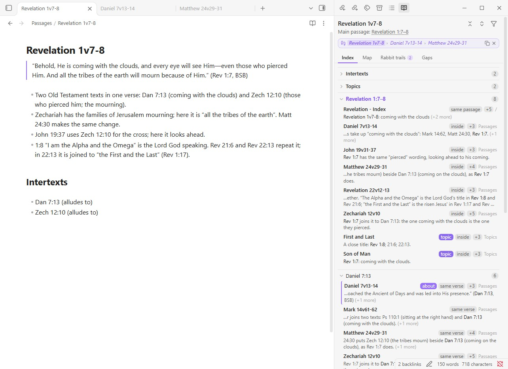

## What it reads

Passage Index reads scripture references in every note and treats variants as the same verse:

- `Mark 11:17`, `Mk 11:17`, `Mark 11.17`, `Mark 11v17`, `Isa. 56:7`, `1 Sam 3:4`, `I Sam 3:4`
- **Ranges:** Mark 11:17 falls inside Mark 11:15–19. Ranges across chapters work too (`14:62–15:1`).
- **Chains:** `Dan 9:27; 11:31; 12:11` gives three Daniel references. So do `Rom 8:28, 30` and `Isa 41:4, 44:6 and 48:12`.
- **References in parentheses:** `Zech 14 (cf. 14:4; also 14:21)`.
- **Filenames:** `Isaiah 56v7.md` or `The Son of Man (Matt 24.30).md`. The passage in a note's filename is its **main passage**. A `passage:` property in frontmatter overrides it (another property name can be set in settings). A note without one shows **Set main passage…** at the top of the pane.
- **Beyond the Bible:** 1–2 Enoch, Jubilees, the Testaments of the Twelve Patriarchs, the Testament of Job, 1QS, 1QM, CD, the Apocrypha and 4 Ezra (chapter:verse forms).

Links count by their display text. A link without display text counts only if the linked note's name starts with a passage (`[[Mark 1v15]]`).

## The pane

Open it from the ribbon icon or the command **Passage Index: Open pane**. It updates whenever you open a note, and re-reads a note shortly after you stop typing.

The top of the pane names the note and its main passage. **Click the main passage** to read it (see *Verse pop-up*).

The pane has four tabs: **Index**, **Map**, **Rabbit trails** and **Gaps**. The Index tab starts with **Rabbit trails**, **Intertexts** and **Topics** (each only when it has something to show), then the passage groups. Above the tabs, the **trail** shows the notes you've opened along the way.

### Index

- One group per passage the note cites. The main passage comes first, the others follow in canonical order, each with a note count.
- Within a group, notes **about** the passage (their own main passage overlaps it) come first, then the others by how their reference fits the passage: **same verse** (or *same passage*, *same chapter*: it cites exactly this reference), **inside** (part of it), **contains** (a wider passage that includes it), **overlaps**, then **chapter** (only the chapter is mentioned). These describe the references, not the wording: *same verse* doesn't mean the note quotes it. Point at a tag to read it as a sentence (*Cites Daniel 7:9–14, which includes Daniel 7:13*).
- Each result shows the folder and the line with the reference highlighted.
- **Click** a result to open it in a new tab with the cursor on that line. The reference is briefly highlighted.
- **Hold Ctrl** (Cmd on a Mac) and point at a result to preview the note at that line. To preview without the key, turn off *Passage Index* under **Settings → Page preview**. A plain point shows what a tag means.
- **Hold Ctrl** (Cmd on a Mac) and point at a passage heading to read the verses (see *Verse pop-up*).
- A passage with no other notes says so, with **Start a note** (see below).

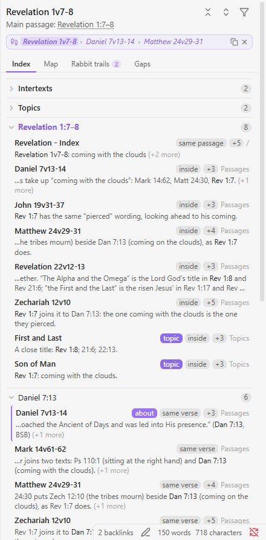

#### Right-click a result

- **Open in new tab** or **Open to the right**.
- **Insert link at cursor:** puts a link to that note where your cursor is in the note you're reading. Select some text first and it becomes the link's display text. In reading view there's no cursor, so the link is copied instead.
- **Copy link**, **Copy this line**, **Reveal in file explorer**.

#### Right-click a passage heading

- **Open in Logos** (and Bible Gateway, Blue Letter Bible or STEP Bible, if you turn them on in the *Open in* tab). Logos opens in the app if it's installed, otherwise on the web.
- **Show in this note:** jumps to where the note you're reading cites the passage.
- Open the note about this passage, copy the passage, copy links to all its notes as a list, or open them all in tabs.
- **Start a note on …** (when no note is about this passage) and **Save as a rabbit trail…**.
- **Show in Map:** the Map tab at that passage, with its notes and Connections. Also in the right-click menus of the Rabbit trails and Gaps tabs.
- **Add … as an intertext…** (see [Intertexts](#intertexts)).
- Collapse or expand the groups.

### Trail

Open a note from the pane and a trail starts: the note you were reading, then each note you open after it, whether from the pane, a link or a tab. It shows above the tabs as `Revelation 1v7-8 › Daniel 7v13-14 › Matthew 24v29-31`.

- **Click** a step to go back to it. Its tab comes to the front, or the note opens again at the line you opened it on.
- **Hold Ctrl** (Cmd) and point at a step to preview it.
- Go back to an earlier step and open something new, and the steps after it are dropped, as with a browser's Back.
- Long trails fold in the middle; click **…** for the hidden steps.
- The buttons at the end go back to the start, copy the trail as links (`[[A]] → [[B]] → [[C]]`), or end it.
- **Click the footprints** at the start of the trail for a list of its notes. Click one to go there, or **×** to take a detour out of the trail; the steps on either side join up. The note you're on stays.

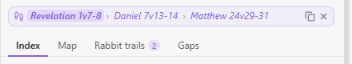

The trail is kept until you end it or restart Obsidian. Where the notes open is a setting: a new tab for each, or one trail tab that's reused.

### Start a note

When a passage has no note of its own, **Start a note** (in an empty group, the Gaps tab, or the right-click menu) makes one. A small window asks for the name and folder (both suggested, both editable), says how Passage Index will read the name, and shows what the note will contain. Nothing is written until you choose **Create**.

The new note is plain, with no properties or template, so you can add your own. Its body starts with the trail that led to it:

```markdown
Trail: [[Revelation 1v7-8]] → Revelation 14:14
```

The note opens with the cursor below that line and becomes the next step of the trail.

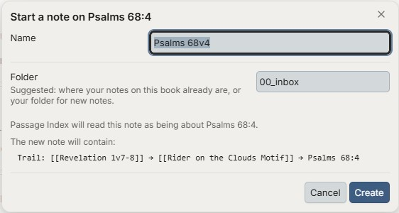

### Rabbit trails

A passage you want to look into later, without leaving what you're reading. Right-click a passage heading and choose **Save as a rabbit trail…**, add a line about why if you like, and Passage Index adds a line to your rabbit-trails note (`Rabbit trails.md` unless you choose another in settings):

```markdown
- Daniel 7:13 — why does John join it to Zech 12:10? (from [[Revelation 1v7-8]], 2026-11-14)
```

- In the Index tab, a **Rabbit trails** section shows the saved lines that touch a passage the note cites, and the ones saved from this note (*from here*).
- The **Rabbit trails** tab lists them all, newest first or in Bible order. Right-click one to open it, open the note it came from, start a note on it, show it in the Map, copy it or remove it.
- When you're done with one, choose **Remove (done with it)…** (it shows the line and asks first) or delete the line yourself.

The rabbit-trails note isn't listed under passages and isn't counted in the Map.

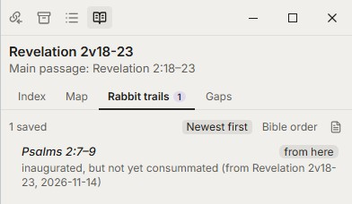

### Topics

Lists topic notes that share a passage with the note you're reading, unlinked ones first, so you can see which topics you haven't linked yet. Which notes count as topics is set in the *Topics* tab.

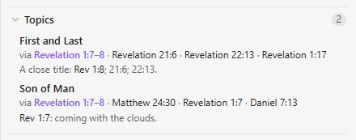

### Intertexts

Record where one passage quotes, alludes to or echoes another, and the pane shows the link from both ends.

**The easy way: Add intertext….** Right-click a reference in your note, or a passage heading in the pane, and choose **Add … as an intertext…**. You can also use the command **Passage Index: Add intertext…** or the **Add intertext…** link in the pane's Intertexts section. A small window asks for:

- **Other passage:** one passage, e.g. *Acts 13:33*.
- **How they connect:** a plain sentence with both passages in it, e.g. *Acts 13:33 quotes Psalms 2:7–9* or *Psalms 2:7–9 alludes to 2 Samuel 7:14*. Choose whichever is true; you don't need to know which end you're on.
- **Source** and **Note:** who points it out (*Bratcher 1991, 29*) and a few words on the link. Both optional.

It shows the line it will write, and where the link will show, before you choose **Add**. The line goes at the end of the note's Intertexts section, and the section is made if the note doesn't have one.

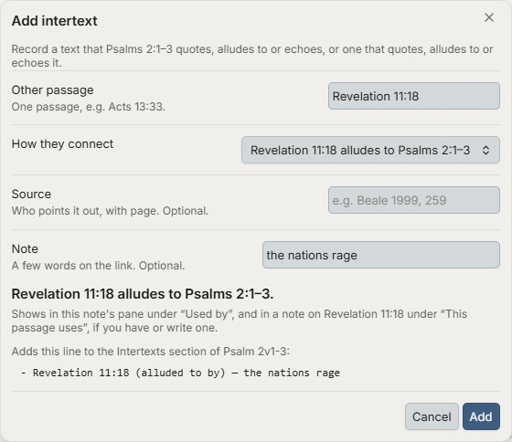

**What the pane shows** in the Intertexts section:

- **This passage uses:** the texts this passage quotes, alludes to or echoes, e.g. *2 Samuel 7:14 · alluded to*. Clicking one opens that passage's note (e.g. `Isaiah 56v7`), if you have one.
- **Used by:** the texts that quote, allude to or echo this passage, e.g. *Acts 13:33 · quotes*. They come from this note's own lines and from other notes that point to this note's main passage. Open `Isaiah 56v7` and you see that Mark 11:17 quotes it.
- **Open questions:** other notes' unfinished `#intertext` tasks naming this passage.

Point at a row to read the link as a sentence (*Acts 13:33 quotes Psalms 2:7–9*). A link recorded in both notes is listed once. To remove one, right-click it and choose **Remove this intertext…**: it shows the line before deleting it and, if the link is recorded in both notes, offers to remove both. Deleting the line yourself works too. A passage note with no intertexts yet shows an **Intertexts · none yet** section with the **Add intertext…** link.

**Cited here, not yet intertexts.** The section ends with the passages the note cites that aren't recorded as intertexts yet, so you don't have to remember to check. Click one to open **Add intertext…** with it filled in. Left out: passages in the note's own book, chapter-only references, the note's own passage, and anything already recorded at either end. Overlapping references are combined (*Matthew 24:42–44 ×2*). When a note has no intertexts and something to suggest, the section starts open (*none yet · 2 cited here*). These are suggestions only: a cross-reference isn't always an intertext, and nothing is written until you choose **Add**.

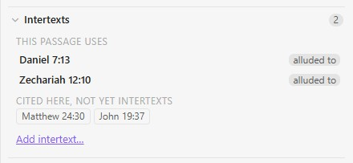

#### Writing the lines yourself

The window writes ordinary lines you can also type or edit. Under an `## Intertexts` heading (any level works; to use another name, such as *Intertextual Connections*, add it in the Index tab of settings), one passage per line:

```markdown
## Intertexts

- 2 Sam 7:14 (alludes to) — the Davidic covenant
- Acts 13:33 (quoted by; Bratcher 1991, 29)
- Matt 3:17 (alluded to by) — the baptism
```

- **The word in parentheses** says how they connect. *quotes*, *alludes to*, *echoes*: this passage uses the one listed. Add *by* (*quoted by*, *alluded to by*, *echoed by*) when the listed passage uses this one. Passage Index looks only at the start of the word, so *quoted*, *quotation*, *allusion* and *echo* work too. Anything else (for example *mentions*), or no parentheses, is listed without a kind.
- After a `;`, the rest is the source. After ` — `, a short note.
- Only the first reference on a line is read, so put each passage on its own line.

**Open questions** go anywhere in a note as tasks tagged `#intertext`:

```markdown
- [ ] Does Jer 8:13's fig imagery explain the fig tree? #intertext
```

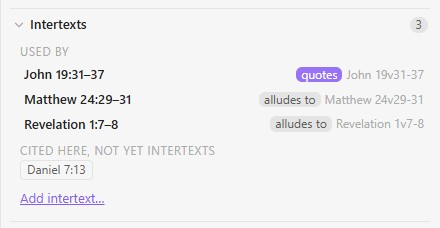

### Map

A coverage map of the main passage's book: one square per chapter, shaded by how many references fall in it (none, 1, 2–3, 4+). A dot marks chapters and verses that are some note's main passage, and your current note's are outlined. Click a chapter to see its verses; click a verse to list the notes citing it, with its Connections below. Pick any other book from the book list.

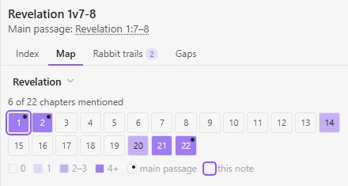

**Also cited with**, below a chapter's verses, lists the other chapters that notes on this chapter cite, most notes first: *Notes on Rev 1 also cite Dan 7 · 4, Zech 12 · 3 …* A note on this chapter, or a topic note, counts in full; any other note counts only what it cites in the same paragraph as this chapter, or under a heading for one of its verses, plus its own main passage, so a long note on another passage that mentions it once doesn't flood the list. Index notes are left out. Click a chapter to see the notes and the verses they cite there (`7:9, 7:13–14`); click a note to open it at the reference. Ctrl-hover a chapter to read it.

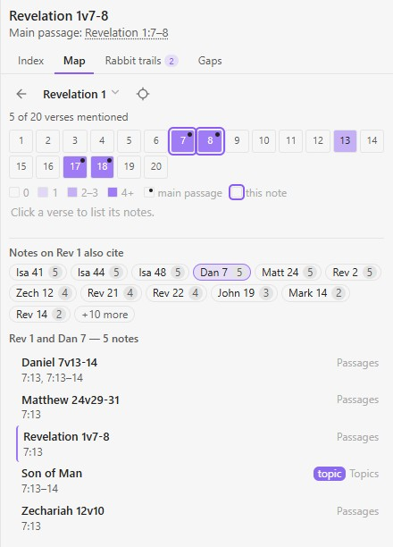

#### Connections

Pick a verse in the Map and, below its notes, **Connections** shows the passages your notes connect with that verse: the verse in the centre, Old Testament passages on the left, New Testament on the right, and thicker lines where more notes make the same connection. It starts with the passages cited by 2 or more of the notes (*Show all* for the rest). Click a passage to put it in the centre and follow the thread; click a line to see the notes behind it. The command **Passage Index: Open connections** opens it in a tab of its own, centred on the main passage of the note you're in (the verse shown before stays in the tab's history).

What counts as a connection: a topic note, or a short note about the centre verse (a main passage of two verses or fewer), counts as a whole. Any other note counts only what it cites in the same paragraph as the centre verse, or under a heading for that verse (`### 3:5 …`), plus its own main passage. Index notes (by default, notes with `type: index` or `type: book`) gather everyone else's references, so they're left out, and the summary says how many (*1 index note left out*).

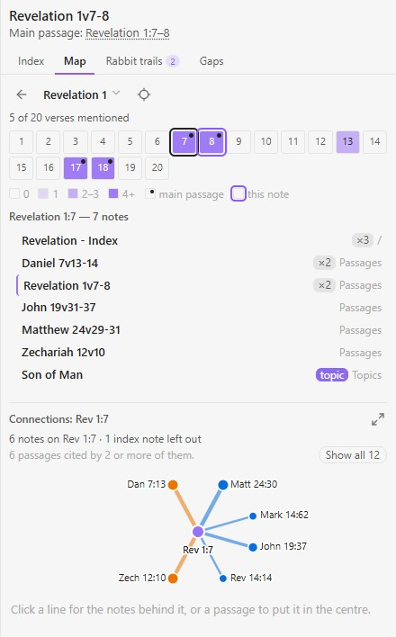

The command **Insert coverage map** adds a live `pi-map` code block to a note:

````
```pi-map
Revelation
```
````

### Gaps

Verses your notes cite that have no note of their own: a list of what you might write next. A verse counts as written when some note's main passage overlaps it (so `Rev 1:7–9` counts if you have `Revelation 1v7-8`). Chapter-only and broad references are left out.

- **Most cited** first (or **Bible order**, by book), with the number of notes citing each. Pick a book to narrow the list.
- Open a row to see the notes that cite it; click one to open it at the reference.
- **Start a note** from the row, or right-click to save it as a rabbit trail or copy the reference. Passages already saved as rabbit trails are tagged.
- A row disappears as soon as a note on that passage exists.

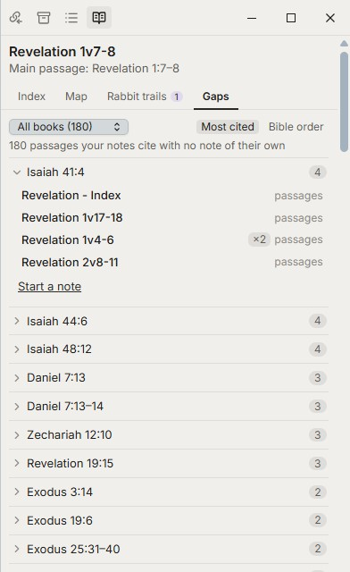

## Verse pop-up

Hold **Ctrl** (Cmd on a Mac) and point at a passage in the pane to read the verses, or click the main passage at the top of the pane (click again or press Esc to close). The pop-up uses a hidden copy of a translation that Passage Index downloads once (see *Translations*). With more than one downloaded, switch between them in the pop-up.

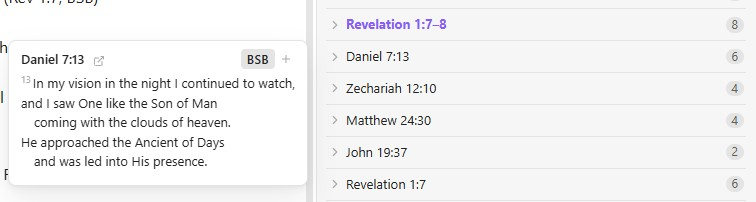

The small arrow beside the reference in the pop-up opens the passage in Logos, Bible Gateway, Blue Letter Bible or STEP Bible. With one of them turned on, it goes straight there; with several, it shows a menu.

## Settings

### Index

- **Excluded folders:** notes here are never indexed.
- **Not references:** phrases that look like passages but aren't, such as a book title you cite (`Mark 1–8`).
- **Ignore property:** a frontmatter property listing references a note cites only in passing, e.g. `pi-ignore: [Acts 11:28]`. The note gets no group for them and won't appear under them elsewhere. The command **Ignore (or stop ignoring) the reference at the cursor in this note** edits it for you.
- **Main passage property:** the frontmatter property giving a note's main passage when its name has none (default `passage`). If your notes already use another, such as `ref`, enter it; several names, comma-separated, are tried in order. The command **Set main passage of this note…** writes it for you.
- **Intertexts headings:** the heading names that start a note's Intertexts section, one per line (default *Intertexts* and *Intertext*). Any heading level; the whole heading must match; case is ignored.
- **Rebuild index:** rarely needed; notes are re-read as you edit them.

### Topics

Topic notes are notes about a subject rather than a passage. A note counts as a topic if a frontmatter property (e.g. `type: topic`) has one of the values you list, or if it sits in one of your topic folders.

### Pane

- **Group passages by section (pericopes):** groups the note's passages under a translation's section headings (BSB, LEB or TCENT; download one in the Translations tab).
- **Hide broad matches** and **Hide chapter-only mentions**, with a button in the pane to show them.
- **Highlight duration** and **Hover previews**.
- **Trail: open notes in:** a new tab for each note (default), or one trail tab that's reused, so Obsidian's Back and Forward work in it.
- **Rabbit trails note:** where saved rabbit trails go (default `Rabbit trails.md`). It's read even if it's in an excluded folder.
- **Connections:** which notes count as index notes and are left out of Connections and Also cited with: a frontmatter property and its values (default `type`: `index`, `book`).

### Translations

Downloads translations as hidden copies (in the plugin's folder, not notes) for the verse pop-up and for sections. Each downloaded translation shows its license and terms. Translations come from [bible.helloao.org](https://bible.helloao.org); any id from its list can be used.

### Open in

Turn on the apps you want in the right-click menu and the pop-up: **Logos**, **Bible Gateway**, **Blue Letter Bible**, **STEP Bible**. Each can open a set version; leave it blank for the site's default. Bible books only.

### Bible

**Add a Bible to your vault** (optional) opens a wizard that writes a whole translation into your vault as notes: one note per chapter, each verse a small heading you can link to (`[[Revelation 1#12]]`). Options include section headings, footnotes, previous/next links, index notes, aliases and Breadcrumbs properties. These notes are separate from the Translations tab's hidden copies. The Bible's folder is excluded from the index automatically.

Also here: how verse numbers look, opening chapters in reading view, and keeping Bibles out of Obsidian's search. Each Bible you've added can be opened, regenerated or removed (to the trash).

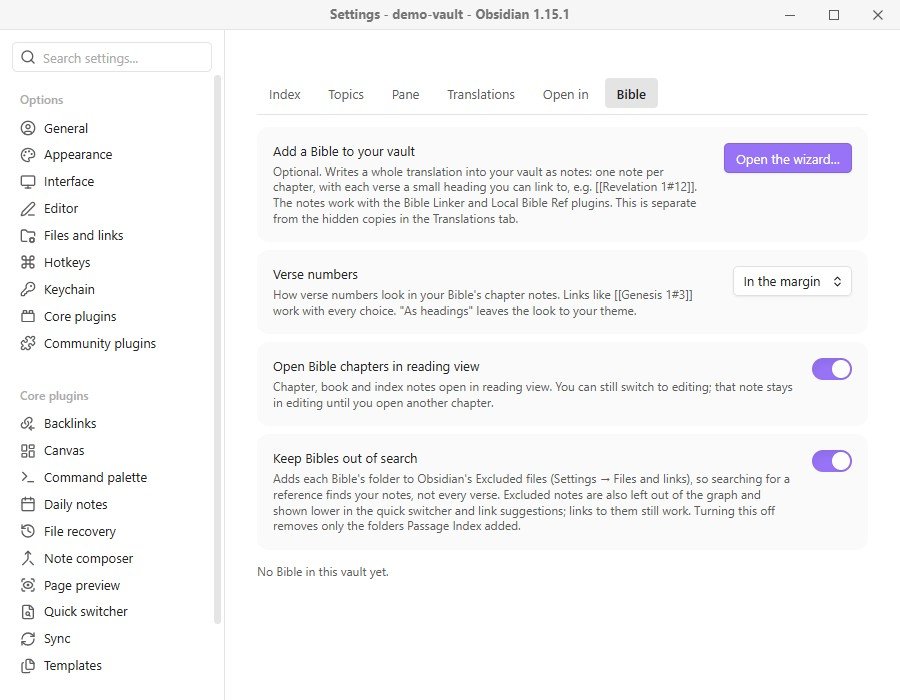

## Network use

Passage Index reads your notes locally. It goes online only when you ask it to:

- downloading a translation (Translations tab) or adding a Bible (Bible tab), from `bible.helloao.org`;
- opening a passage in Logos (`ref.ly`), Bible Gateway, Blue Letter Bible or STEP Bible, in your browser or app.

No telemetry, no accounts.

## Omnisearch

If you add a Bible to your vault and use Omnisearch, turn on Omnisearch's option to respect Obsidian's excluded files. Otherwise the Bible's chapters fill your search results even with *Keep Bibles out of search* on.

## License

MIT. Translations keep their own licenses, shown in the Translations tab.
